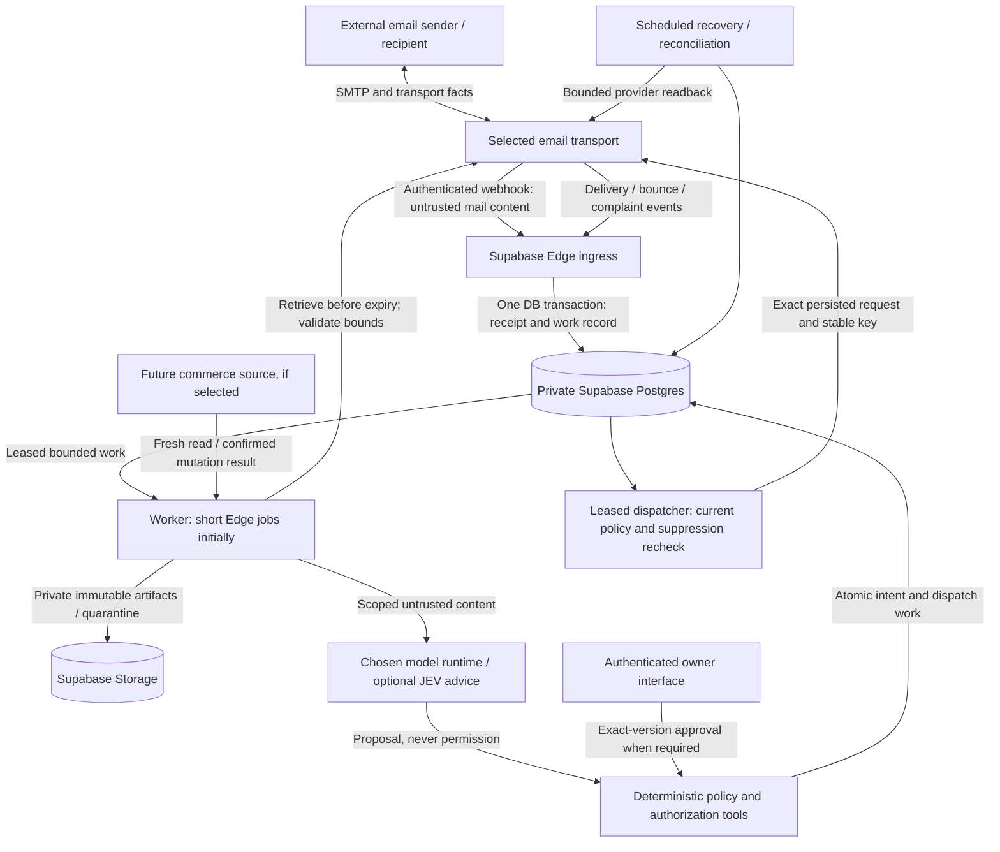

# Proposed email architecture and minimal contracts

**Design, not deployed functionality.** Provider selection and its proof gates are in the
decision brief. This is one email workflow, not a universal communications service. No new
schema, queue, runtime or provider configuration is installed by this document.

## Ownership and execution

The trust boundary is not simply “outside vs inside Supabase”: stored emails, attachments,
model outputs and imported provider facts remain untrusted data inside it. Ingress verifies
transport origin; that does not authenticate the author as the owner or authorize an order change.

Supabase owns canonical operational records, identities, conversation assignment, policy,
approvals, work leases, sends requested and audit history. Transport owns SMTP acceptance,
attempts, delivery reports, sending-domain verification, reputation and mandatory suppression
infrastructure. Local suppression is an additional safety restriction, never permission to
override provider suppression. Provider acceptance and recipient-server delivery are distinct;
neither proves a person read the email. A read/open tracking pixel is not reliable human-read proof.

Storage owns captured artifacts under a separately tested backup/restore plan. A Postgres row
pointing to an object does not prove that object was backed up. Models execute outside Postgres;
which model/runtime to use is unresolved, not an implied new vendor recommendation.

Start with bounded network/normalization/dispatch tasks in Edge only if measured CPU, memory,
wall time and payloads fit its current limits (execution dossier). Do not rely on post-response
background work as the durable queue. Move MIME-heavy parsing, malware scanning, large artifact
capture or long-running model/tool work into one constrained external worker **when those jobs
require it**; keep state and leases in Supabase. No worker fleet or orchestration framework is
necessary before that need is demonstrated. Unsupported/oversize attachments are quarantined,
not silently omitted or treated as successful messages.

## Inbound path and safe acknowledgment

1. Verify exact provider contract over raw bytes/required URL and headers before parsing;
   enforce request bounds and timeouts. Do not adapt the existing Svix code to Bird by renaming headers.
2. In one restricted database call, insert unique scoped delivery receipt plus durable work.
   Store event type/version, provider/account scope, received/event times, payload hash and the
   bounded event body or immutable artifact reference needed for recovery. Existing Resend
   metadata-only receipts are insufficient for new inbound processing.
3. Acknowledge only after commit. If commit failed, return retryable failure. If commit succeeded
   but acknowledgment was lost, duplicate receipt resolves to existing work and succeeds.
   Same event ID with different bytes is a conflict to investigate, not overwrite.
4. Capture complete inbound content, original headers and attachments before the provider's
   retention/access deadline. A committed pointer is only durable **work**, not durable content.
   If provider only pushes content and has no replay/retrieval, acknowledge only after that content
   is safely persisted. For Storage + DB (not one transaction), write deterministic immutable
   objects, verify hash/length, then commit references; sweep orphans without deleting referenced
   objects. Do not feed the agent until capture is complete or an explicit incomplete state is set.
5. Deduplicate normalized inbound messages separately from delivery events. Preserve original
   message and transport IDs with scope; Message-ID alone is attacker-controlled and not a global
   unique key. One inbound message can arrive through multiple recipients or webhook attempts.
6. Resolve receiving identity from trusted server-side route evidence, not visible To/Cc. Bird's
   inspected GET/LIST describe header recipients; original envelope recipient is not established.
   Phase 0 must prove one dedicated route-to-identity mapping that survives LIST backfill (or an
   actual documented envelope field). Bcc-only, forwarding, two aliases and header mismatch are
   acceptance fixtures; missing/contradictory route evidence holds/quarantines. Resolve thread
   hints separately; ambiguous relationships stay unresolved. Address
   equality and subject similarity do not establish customer identity or authority. Acquire a
   conversation revision/lease before proposing one response intent.

## Minimal logical records (proposed, not separate microservices)

| Record                      | Necessary fields / invariant                                                                                                                                                                                                                                                           |
| --------------------------- | -------------------------------------------------------------------------------------------------------------------------------------------------------------------------------------------------------------------------------------------------------------------------------------- |
| `email_identity`            | Internal ID, address/domain, allowed sender/reply role, verified provider binding, enabled state; departmental address is not an agent account                                                                                                                                         |
| `email_event`               | Provider/account, delivery ID unique within scope, payload hash, type/version, occurred/received time, durable capture reference, processing state/error; append facts                                                                                                                 |
| `email_message`             | Internal ID; direction; scoped provider ID; envelope sender/recipients separate from visible From/To/Cc/Reply-To; original Message-ID/In-Reply-To/References; subject; body/artifact refs; original headers/MIME when supplied; capture/authentication facts; conversation ID nullable |
| `email_artifact`            | Message ID, immutable object path, hash, bytes, declared/detected type, filename/disposition, capture/quarantine/scan state, retention class; never an expiring URL as the only copy                                                                                                   |
| `email_conversation`        | Internal ID, participants/relationships, external references and resolution confidence, assigned worker role, revision, workflow state; no order-number-only access                                                                                                                    |
| `email_action`              | Intent UUID, kind, exact content/recipient/identity/artifact digest, conversation revision, policy version, source preconditions, approval requirement, status, expiry; amendments create a new version                                                                                |
| `email_approval`            | Action digest/version, authenticated actor, granted/declined/expired, timestamp/expiry and consumed intent; email claims cannot create approval                                                                                                                                        |
| `email_attempt`             | Intent ID and attempt ID, exact request digest, provider idempotency key if supported, start/end, accepted ID, outcome including `unknown`, next reconciliation time; accepted is not delivered                                                                                        |
| `email_work`                | Unique business work key, type/reference, available time, attempt count, lease owner/token/expiry, outcome/error and terminal/dead state; can be implemented by one Postgres work table initially                                                                                      |
| `email_suppression` / audit | Address and purpose scope, source/reason/event, active restriction; append authorization, state transition and execution evidence with sensitive-log minimization                                                                                                                      |

Do not automatically create these as eleven public tables. Logical records can share an
appropriately structured private table where constraints remain clear. No customer Data API
access or broad grant to service_role merely for convenience. Use restricted operations with
fixed search_path and explicit EXECUTE grants; worker credentials have narrower operations than
database administrators. Design and test owner authentication before exposing an owner UI.

One leased Postgres work table is sufficient for the first workflow and makes receipt+work
atomic without adding an extension. PGMQ is a credible later implementation of that queue
contract, **not installed here**; see its exact lease/atomicity limits in execution.md. A queue
message is a wake-up hint referencing canonical work state, not the only evidence an action exists.

## Interfaces and state transitions

Names are illustrative restricted backend operations, not promises of existing RPCs:

- `accept_event(scope, delivery_id, hash, verified_event)` → existing/new receipt and work ID;
  only trusted ingress may call, size/type checked in code and SQL.
- `claim_work(worker_identity, capability, limit, lease_duration)` → bounded items and fencing
  tokens; server-selected limits and one current owner. Reclaim expired leases with a new token.
- `complete_work(id, token, expected_revision, outcome)` → update and next work in one transaction;
  stale token fails. Time-dependent actions recheck actual clock, not just lease ownership.
- `propose_reply(conversation, expected_revision, exact_message)` → immutable action version;
  no arbitrary sender identity, recipient expansion or cross-customer artifact reference.
- `authorize_action(action_version)` → standing-policy grant or pending owner approval; unknown
  action kinds denied. Model/JEV recommendation is evidence, not the result of this check.
- `approve_action(authenticated_owner, digest, expires_at)` → approval for that version only;
  server enforces configured duration. No advertising duration is configured by this proposal.
- `begin_dispatch(action_id, token)` → exact stored request only after policy, expiry, suppression,
  current revision, kill-switch and previous-attempt checks. Persist attempt **before** network call.
- `record_send_outcome(attempt_id, token, response_or_unknown)` → accepted/rejected/unknown;
  never change unknown to “not sent” merely because the worker timed out.

Work: `ready → leased → done`, or `leased → retry_wait → ready`, or `dead` after a configured
bounded retry policy. Reclaiming a lease does not erase attempt history. Conversation revisions
prevent two agents independently committing replies to the same revision. New customer messages
invalidate stale drafts when relevant. A completed intent has one business identity even if its
network request was attempted multiple times.

### Initial work-table transition contract

This is the selected implementation contract; the PGMQ SQL in execution.md is deferred.
All operations below are short restricted DB transactions; no network call runs under a lock.
Use a single consistent row-lock order (work → action/outbox → attempt), database time,
server-selected limits/durations, and verify every guarded update affected exactly one row.

1. **Intake:** unique `(provider, account_scope, delivery_id)` receipt plus `work(business_key,
kind, receipt_id, status=ready, available_at, fence=0)` in the same transaction. On receipt
   conflict compare stored digest in a separate statement after the concurrent winner commits;
   same content returns existing work, different content raises conflict. A failed insert of work
   rolls the entire new intake back. Message-level business-key conflicts reuse existing capture
   work while retaining the distinct event receipt. No queue extension call is needed.
2. **Claim:** select eligible ready/retry-wait work with `available_at <= DB now`, or expired
   leased **idempotent non-send** work, using `FOR UPDATE SKIP LOCKED`. Prioritize nearest capture
   deadline, then available time/ID; dispatch has a separate per-run budget so it cannot starve
   capture. Atomically set leased, increment monotonic fence/attempt count, set authenticated
   worker identity and lease expiry. Return only that token and bounded work after commit.
3. **Heartbeat:** update lease expiry only for matching ID, worker, fence, leased state and an
   unexpired lease, with a server-side maximum extension. Zero rows means lost ownership; stop
   and do not commit outcome. Heartbeat cannot resurrect an expired lease.
4. **Complete:** lock work and require matching worker/fence, leased state and unexpired lease.
   Persist artifacts/result and any unique next work, then mark done in the same transaction.
   Late/duplicate completion cannot create a second next action. Artifacts use deterministic
   immutable paths/hash verification, not a claim of atomic DB/object commit.
5. **Retry/dead:** same ownership guards; increment bounded error budget and choose retry-wait
   with server-calculated backoff/jitter or dead. Clear lease ownership; retain attempts. Dead-work
   replay is an authorized audited transition preserving the original business key. Ready/retry
   scans are the queue: loss of a Cron wake-up cannot erase work.
6. **Begin send:** under work → action → attempt locks, enforce live token and all policy guards;
   transition action to dispatching and insert its unique attempt with exact frozen request.
   Commit **before** HTTP. Do not reclaim dispatching as a new send. A stale process can still
   reach the network after this commit, so lease expiry never authorizes a concurrent replacement.
7. **Expired dispatch sweep:** dispatching beyond its deadline becomes acceptance-unknown and
   gets **reconciliation**, not dispatch, work. Positive provider acceptance evidence may resolve
   accepted; record any late response for that same attempt immutably and resolve under guarded
   state checks. Contradictory evidence becomes an exception, never a second automatic send.
   No-match remains unknown. A known rejection/retry has to be classified by the exact provider
   contract and must not conceal any earlier unknown attempt. Manual resend creates a separately
   recorded decision acknowledging duplicate risk; it is not silent queue recovery.

Implementation tests must exercise these guards in actual disposable Postgres, with concurrent
transactions and process crashes. The research model is not their substitute. Add partial indexes
for eligible ready/retry work and lease expiry plus unique business/event/intent keys, then verify
query plans against representative fixture size; do not choose scale-oriented partitioning now.

Action: `proposed → authorized → dispatching → accepted`, with `pending_approval`, `declined`,
`expired`, `blocked`, `unknown` and `rejected` explicit alternatives. Delivery facts are append-only,
separate from workflow: delayed events cannot overwrite a complaint or reactivate a suppression.
Do not impose one simplistic total order on delivered, bounced and complained events.

## Critical outbound crash window

Persisting an outbox is necessary but **does not make external sends exactly once**. A provider
can accept the email and the application can crash before recording its ID. Leases/fencing
protect local writes; they cannot revoke a network request already accepted outside the DB.

Use a stable provider idempotency key bound to the immutable intent **only when the exact API
documents it** and test scope, payload-conflict handling and expiry. Retry the exact same request
within its safe window. After the window, reconcile by an authoritative provider identifier or
documented unique reference/readback. Message-ID or custom metadata is not automatically a
deduplication instruction to a provider. Without a safe resolution, retain `unknown`, block
automatic resend and escalate that exceptional case. Do not silently trade lost messages for
duplicates, or introduce another provider as “automatic failover” for an uncertain send.

## Recovery and deliberately omitted scope

Scheduled sweeps find expired leases, overdue capture, ready work without wake-up, orphan
artifacts, pending/unknown sends, and gaps in provider event history inside its retention window.
Use exponential backoff with jitter and bounded attempts; dead work stays inspectable/replayable
under authorization. Replays preserve business idempotency keys and never reset a sent intent.
Outages pause dispatch while capture/reconciliation retry; emergency controls disable outbound
and commerce mutations independently while safe receipt capture continues where possible.

Do not build omnichannel abstractions, agent-per-mailbox provisioning, a campaign engine,
automatic multi-provider failover, autonomous financial tools, supplier commitment workflows,
or a Shopify migration before actual selection and implemented contracts. No vector database,
event bus, microservice fleet or full helpdesk is required to prove one two-way support workflow.
